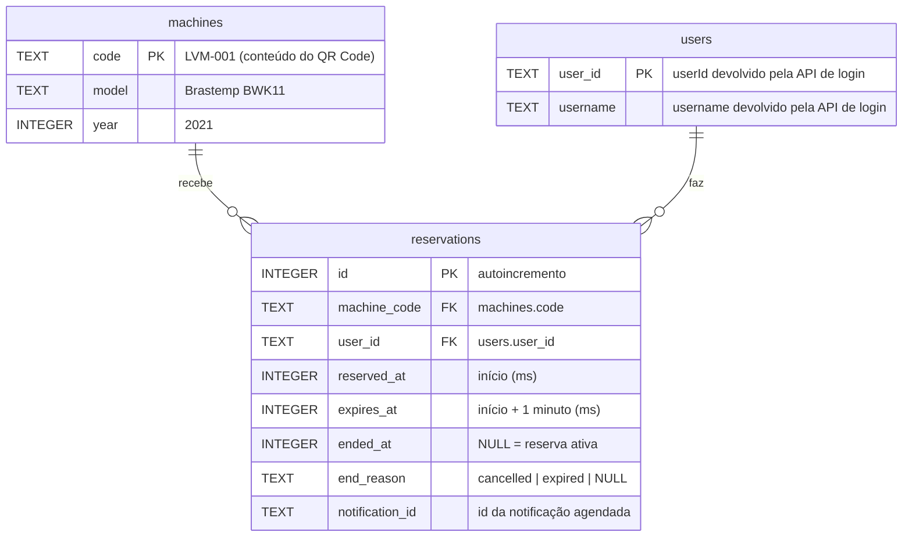

# Banco de dados (SQLite — Android)

No Android, os dados das máquinas ficam num banco **SQLite** (`lavamo.db`, na área privada do app), criado com a biblioteca `expo-sqlite`.
A versão Web continua usando o `bd.json` + AsyncStorage (localStorage).

- Código do banco: [src/integration/database.ts](../src/integration/database.ts) (tabelas, migrações e carga inicial)
- Regras e consultas: [src/integration/machineIntegration.ts](../src/integration/machineIntegration.ts)
- Carga inicial: [bd.json](../bd.json) → copiado para a tabela `machines` na primeira abertura

## Diagrama



## Tabelas

### `machines`
As máquinas da lavanderia. Não existe coluna "disponível": **a máquina está livre quando não tem reserva ativa**.
Assim o status nunca fica dessincronizado da tabela de reservas.

### `users`
Cópia mínima dos usuários que já fizeram reserva. Quem cadastra e autentica é a API de login. O app só guarda o `userId` e o `username` que vêm na resposta do login, para mostrar "Em uso por *fulano*".

### `reservations`
Uma linha por reserva. Reservas encerradas **não são apagadas**: ficam como histórico, com `ended_at` e `end_reason`.

| Situação | `ended_at` | `end_reason` |
|---|---|---|
| Reserva ativa | `NULL` | `NULL` |
| Cancelada pelo usuário | hora do cancelamento | `cancelled` |
| Cancelada automaticamente (tempo acabou) | igual a `expires_at` | `expired` |

## Regras garantidas pelo próprio banco

| Regra de negócio | Como o banco garante |
|---|---|
| Uma máquina só pode ter uma reserva ativa | índice único parcial `ux_reservations_active_machine` em `machine_code` `WHERE ended_at IS NULL` |
| Um usuário só pode ter uma reserva ativa | índice único parcial `ux_reservations_active_user` em `user_id` `WHERE ended_at IS NULL` |
| Reserva só de máquina e usuário existentes | chaves estrangeiras (`PRAGMA foreign_keys = ON`) |
| Encerrada sempre tem motivo (e vice-versa) | `CHECK ((ended_at IS NULL) = (end_reason IS NULL))` |
| Motivo só pode ser `cancelled` ou `expired` | `CHECK (end_reason IN (...))` |
| Prazo sempre depois do início | `CHECK (expires_at > reserved_at)` |

As mesmas regras também são verificadas no `machineIntegration.ts`, que mostra a mensagem amigável ao usuário. Os índices e os `CHECK` são a última linha de defesa.

## Cancelamento automático (1 minuto)

1. Ao reservar, o app grava `expires_at = agora + 1 minuto` e **agenda uma notificação local** no Android para esse horário. O id dela vai para `notification_id`.
2. Antes de toda leitura ou gravação, o app executa:
   ```sql
   UPDATE reservations SET ended_at = expires_at, end_reason = 'expired'
   WHERE ended_at IS NULL AND expires_at <= :agora;
   ```
   Assim, uma reserva vencida nunca aparece como ativa, mesmo que o app tenha ficado fechado.
3. O Android entrega a notificação "Tempo de reserva encerrado" no horário, **mesmo com o app fechado**.
4. Se o usuário cancelar na mão antes do tempo, a reserva é encerrada com `cancelled` e a notificação agendada é cancelada.

## Versão do schema

A versão do banco fica no próprio arquivo (`PRAGMA user_version`). Para alterar as tabelas no futuro, basta criar a migração seguinte em `MIGRATIONS` e aumentar `SCHEMA_VERSION` no `database.ts`. Quem já tem o app instalado recebe só a diferença, sem perder as reservas.
